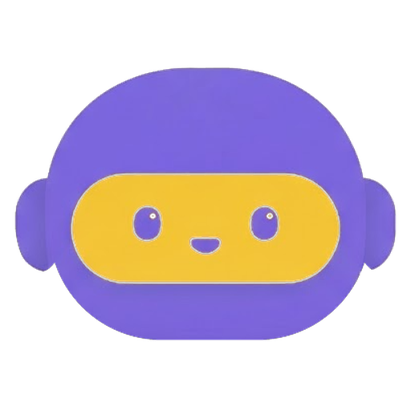

# lets-learn-together



Roadmaps de estudo em português, com prioridade, critério de conclusão e
progresso salvo no navegador.

**→ [Abrir o roadmap](https://masteryogo.github.io/lets-learn-together/)**

## Para quem é

- Quem está **migrando para a área** e precisa de um norte.
- **Cientistas de dados, Engenheiros de IA e engenheiros de ML**

## O que você encontra

- **Prioridade** (fundamental, importante, opcional), para decidir com
  honestidade o que dá para pular.
- **Por que existe e quando morde** - a explicação que falta nos checklists.
- **Critérios de conclusão**: marque como feito quando *isso* for verdade, não
  quando o vídeo acabar.
- **Recursos e projetos sugeridos**, porque fundamento sem prática evapora.

Seu progresso fica salvo no próprio navegador, via `localStorage`. Sem conta,
sem servidor, sem ninguém medindo o seu ritmo.

## Rodando

O site publicado está em
[masteryogo.github.io/lets-learn-together](https://masteryogo.github.io/lets-learn-together/)
— rodar local só é necessário para desenvolver.

O site é feito com [SvelteKit](https://svelte.dev/docs/kit) e publicado como
arquivo estático:

```bash
npm install
npm run dev       # desenvolvimento, com recarga
npm run build     # gera build/
npm run preview   # serve o build/ como em produção
```

As telas:

- `/` — a **mesa de cartas**, onde você escolhe a trilha. Cada trilha é um
  mapa com a rota desenhada: um marco por etapa, o trecho em tinta cheia é o
  que você já andou.
- `/roadmap` — o roadmap em si. Aceita `?trilha=ml` (padrão), `?trilha=cv`,
  `?trilha=langchain`, e também dá para trocar pelo seletor no topo. A
  casinha no canto leva de volta para a mesa.
- `/calendario` e `/notas` — o calendário de estudos e o mural de notas,
  guardados no estojo da mesa.
- `/kanban` — o quadro de trabalho: o que vem por aí e por quê.

Um link antigo no formato `index.html?trilha=cv` continua valendo: a mesa o
repassa para o roadmap.

## Usando o mapa

- **Clique** (ou toque) em um tópico cicla o estado dele:
  Pendente → Estudando → Feito → Pulado → Pendente.
- A marca à esquerda do tópico mostra o estado sem depender da cor:
  `□` pendente, `►` estudando, `■` feito, `×` pulado. A barra colorida na
  margem é a prioridade.
- Para abrir o painel lateral com a explicação completa, os critérios, os
  recursos e os projetos:
  - no **computador**, `Shift + clique` no tópico — ou clique com o botão
    direito;
  - no **celular ou tablet**, toque no **[i]** dentro do tópico.
- Dentro do painel, quando a descrição do tópico é uma lista, ela vira
  **subassuntos marcáveis**. Marcar o primeiro põe o tópico em estudo e
  marcar todos o conclui — você não precisa marcar o tópico à mão. Um
  tópico que você marcou como **pulado** fica imune a isso.
- Cada subassunto tem um **botão de copiar** que leva `Tópico - subassunto`
  para a área de transferência (ex.: `Notação - Funções`), pronto para
  colar numa busca, num caderno de notas ou numa conversa com uma IA.
- **Clique na barra da etapa** abre a introdução dela. Ela fica grudada no
  topo enquanto você percorre a etapa.
- No celular, o painel fecha pelo **×** ou arrastando para a direita.
- A barra no topo acompanha o progresso da trilha inteira.
- Há busca por tópico e alternância entre tema claro e escuro.


## Ajude a popular o roadmap

Este roadmap é uma tentativa de juntar esse conhecimento em um lugar aberto e
em português. Cada coisa que você acrescenta aqui chega a alguém que, agora
mesmo, está procurando exatamente aquilo:

- **Um tópico que faltou.** Procurou no mapa e não achou? Outra pessoa também
  não vai achar. Abre uma issue, mesmo sem propor o texto.
- **Detalhe e critério.** É o que separa um título solto de algo que seja usado por pessoas da área.
- **O recurso que te fez entender.** O que funcionou para você vale mais que a lista canônica que todo mundo linka e ninguém termina.
- **Projetos pequenos** que provam que o tópico foi aprendido.
- **Trilhas novas**: Como inicio, adicionei apenas areas em que ja trabalhei, mas há muito mais a se colocado: **NLP, Robótica, GenAI etc.**

Quanto mais gente contribui, mais a trilha reflete a área de verdade e menos
ela reflete a experiência de uma pessoa só. Não precisa ser especialista: um
tópico, um critério ou um link já colocam alguém alguns passos à frente.

## Como contribuir

Toda contribuição aqui é alguém dizendo "no mundo real não é bem assim":

- **Corrigir um conceito** ou apertar um critério frouxo.
- **Rediscutir prioridades** - o que é fundamental para quem faz NLP não é o
  mesmo para quem faz visão.
- **Trocar um recurso** por um melhor, ou aposentar um desatualizado.
- **Abrir uma trilha nova**: crie `src/lib/trilhas/<id>/` com um `data.js`,
  os `conteudo-*.js` e um `index.js` que os junta na ordem certa; depois
  registre o id no manifesto (`src/lib/trilhas.js`), nos dois lugares — a
  ficha da trilha e o mapa de carregadores:

  ```js
  // em TRILHAS
  nlp: {
    rotulo: "NLP",
    cor: "#2d6a8a",
    etapas: 6,            // confira no rodapé do roadmap
    topicos: 72,          // idem
    rota: [[30,190], [90,160], [150,130], [210,100], [250,70], [275,45]],
  },

  // em CARREGADORES
  nlp: () => import("./trilhas/nlp/index.js"),
  ```

  A `rota` é um marco por etapa, num quadro de 300×240 — é ela que a mesa
  desenha na carta. `etapas` e `topicos` são derivados dos dados, mas ficam
  no manifesto porque descobri-los exigiria baixar as trilhas inteiras só
  para montar a tela de escolha.

Um tópico tem esta cara, mexer nele é editar cinco campos:

```js
{
  id: "validacao-cruzada",       // estável: é a chave do seu progresso salvo
  titulo: "Validação cruzada",
  prioridade: "fundamental",     // fundamental | importante | opcional
  desc: "A linha do checklist - o quê.",
  detalhe: "O porquê, e quando isso morde na prática.",

  // opcional. Quando o `desc` já é uma lista separada por vírgulas, o
  // painel a transforma em subassuntos marcáveis sozinho. Escreva este
  // campo só quando quiser controlar a separação na mão.
  subtopicos: ["k-fold", "estratificado", "leave-one-out"],
}
```

Mantenha o `id` quando editar um tópico existente: é ele que preserva o
progresso de quem já marcou aquele item.

O nome do repositório é literal. Se você aprendeu algo da maneira difícil, essa
cicatriz vale mais que um link de curso.